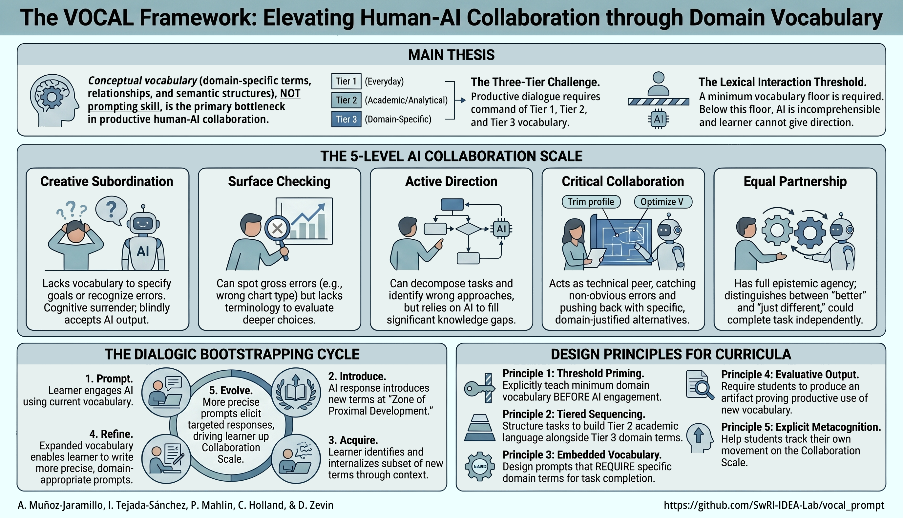

# VOCAL Prompts — Dialogic Bootstrapping Session Prompts

*[Versión en español](#prompts-vocal--prompts-de-sesión-para-bootstrapping-dialógico)*

This repository contains runtime system prompts that implement the **VOCAL Framework** (*Vocabulary-Oriented Collaboration with AI for Learning*), introduced in:

> Muñoz-Jaramillo, A., Tejada-Sánchez, I., Mahlin, P., Holland, C., & Zevin, D. (2026). *The VOCAL Framework: Vocabulary-Oriented Collaboration with AI for Learning in STEAM Education.*

---

## The idea behind these prompts

The VOCAL Framework argues that **conceptual vocabulary — not prompting technique — is the primary bottleneck in productive human-AI collaboration**. A learner who lacks the domain-specific terms to describe what they need cannot be helped by prompting tips alone; the gap is linguistic, not technical.

The prompts operationalize a mechanism called **dialogic bootstrapping**: a positive feedback loop in which iterative AI dialogue builds the vocabulary needed for progressively more effective prompting. Each exchange should leave the learner better equipped to ask the next question.

By default, general-purpose LLMs work *against* this process: they silently translate vague language into precise vocabulary, decompose problems on the learner's behalf, and accept "looks good" as task completion — all of which short-circuit vocabulary acquisition. These prompts install specific countermeasures:

- A **calibration probe** at session opening that estimates the learner's domain level from behavioral evidence, overriding self-reported expertise, claimed terms, and levels carried over from earlier sessions.
- A **three-phase interaction cycle** (engage → introduce → produce) that separates the introduction of new terms from their evaluative use, preventing the learner from skipping productive engagement.
- **Anchor term persistence**: a term identified as the learner's next growth edge is kept from one closure to the next and woven into subsequent questioning until the learner deploys it correctly.
- **Standing rules** that override default behaviors: no silent vocabulary translation, the learner decomposes problems first at Levels 3–4, every output is followed by a question that needs domain vocabulary to answer, and no learner question meets more than one gate before it is answered (none when the learner is frustrated).
- **Session records**: at each closure the tutor prints a LEDGER; on request or at wrap-up it prints a HANDOFF recording, for each target term, whether the learner claimed it, how they first used it, where it ended up, and a verbatim quote. Students paste their latest HANDOFF to continue next session and can submit it to their educator.

Progress is tracked against a **five-level AI Collaboration Scale**, from Level 1 (*creative subordination* — vague goals, no evaluative capacity) to Level 5 (*equal partnership* — full technical direction, nuanced evaluation). The scale is domain-relative: a learner may be at Level 4 in Python and Level 1 in solar physics within the same session.

---

## Available prompts

| Language | Prompt |
|---|---|
| English | [VOCAL\_prompt\_implementing\_dialogic\_bootstrapping\_EN.md](VOCAL_prompts/VOCAL_prompt_implementing_dialogic_bootstrapping_EN.md) |
| Español | [VOCAL\_prompt\_implementando\_bootstrapping\_dialogico\_ES.md](VOCAL_prompts/VOCAL_prompt_implementando_bootstrapping_dialogico_ES.md) |

Current version: **v5.4**. Both files are the same prompt. The Spanish version adds a short *Idioma* section: it runs the session in Spanish, keeps technical terms without an established Spanish translation in their original language, and records each target term exactly as the Brief spells it.

The two versions use these names for the same things:

| | English | Español |
|---|---|---|
| Educator's settings | Brief | Ficha |
| Learner's self-report | Student | Estudiante |
| Record printed at each closure | LEDGER | REGISTRO |
| Progress snapshot | HANDOFF | RELEVO |
| Ask for a snapshot | *handoff* | *relevo* |
| End the session | *wrap up* | *terminar* |

---

## How to use

The full reference for every field is the **How to use** section at the top of each prompt file. In short:

**Educators**

1. Fill in the **Brief** inside the SESSION PROMPT section: `activity` (one line on what the student is working on), `domains` (each with an optional milestone level, 1–5), `targets` (the terms students should be able to use, grouped by domain), and `conventions` (framings to use or avoid). Leave any field you are unsure about empty; an empty field is better than a guess.
2. Give the file to your students. If you collect HANDOFFs, tell them so.

**Students**

1. Fill in the **Student** section: `length` (short, medium, or long) and `I can already use` (target terms you could already use correctly in a sentence of your own). Both are optional.
2. Paste everything under **SESSION PROMPT** (not the notes or the example Brief above it) into a new conversation with your LLM of choice, followed by the HANDOFF from your last session if you have one, then your question.
3. Let the session run. The tutor opens with a calibration probe, introduces bolded terms in context, asks you to use them, and closes cycles with a short reflection and a LEDGER.
4. Type *handoff* at any time for a snapshot of your progress, or *wrap up* when you are done. Keep the latest HANDOFF for next session, and submit it if your educator collects it.

**Self-learners** can fill in the Brief themselves or leave it empty; the prompt works either way.

### A note for educators

- **The Brief is fixed for the session.** A filled field holds for the whole session and is not renegotiated with the learner.
- **A milestone is neither a working level nor a ceiling.** The calibration probe sets the learner's working level in each domain. When a domain reaches its milestone, the tutor says so and keeps going; the milestone marks progress, not a stopping point.
- **Targets drive the session.** The tutor prefers undeployed targets when introducing terms, draws its anchor terms from them first, and writes one HANDOFF line per target.
- **Conventions** are framings the tutor uses or avoids. It never introduces a framing you asked it to avoid, and asks the learner to restate when they use one.
- **Reading a HANDOFF.** Each target line records `claim` (whether the learner said they could already use it), `prior` (whether their first use, before the tutor defined it, was correct), `end` (deployed, misused, introduced, or unused), and the learner's most recent use as a verbatim quote of at most 15 words, or `no quote`.

---

## Contributing

We welcome discussion, suggested modifications, and new prompts with specific pedagogical objectives. These prompts are actively tested and revised as part of the ButterflAI program — an 11-week undergraduate research experience in solar physics built around the VOCAL Framework. Open an issue or pull request to contribute.

## Acknowledgements

The ButterflAI program is part of [NASA's Consequences Of Fields and Flows in the Interior and Exterior of the Sun](https://coffies.stanford.edu/) (COFFIES) Science center.  This work was supported by the COFFIES DSC Cooperative Agreement 80NSSC22M0162.

---

# PROMPTS VOCAL — Prompts de Sesión para Bootstrapping Dialógico

*[English version](#vocal-prompts--dialogic-bootstrapping-session-prompts)*

Este repositorio contiene prompts de sistema que implementan el **Marco conceptual VOCAL** (*Vocabulary-Oriented Collaboration with AI for Learning* — Colaboración con IA orientada al aprendizaje de vocabulario), introducido en:

> Muñoz-Jaramillo, A., Tejada-Sánchez, I., Mahlin, P., Holland, C., & Zevin, D. (2026). *The VOCAL Framework: Vocabulary-Oriented Collaboration with AI for Learning in STEAM Education.*

---

## La idea detrás de estos prompts

El Marco VOCAL propone que **el vocabulario conceptual — no la técnica de prompting — es el principal limitante en la colaboración productiva con IA**. Un usuario que carece de los términos específicos, usados en un campo del conocimiento para describir lo que se necesita, no puede ser ayudado con guías de prompting; la brecha es lingüística, no técnica.

Los prompts operacionalizan un mecanismo llamado **bootstrapping dialógico**: un ciclo de retroalimentación positiva en el que el diálogo iterativo con la IA construye el vocabulario necesario para un prompting progresivamente más efectivo. El objetivo es que cada intercambio deje al usuario mejor equipado para formular la siguiente pregunta.

Los LLMs de propósito general trabajan, por defecto, *en contra* de este proceso: traducen silenciosamente el lenguaje cotidiano a vocabulario preciso, descomponen los problemas en nombre del usuario y aceptan "parece bien" como una tarea completada — todo lo cual evita la adquisición de vocabulario. Estos prompts instalan varias medidas específicas para evitar esto:

- Una **sonda de calibración** al inicio de la sesión estima el nivel del aprendiz a partir de evidencia conductual, invalidando la experiencia autodeclarada, los términos declarados y los niveles traídos de sesiones anteriores.
- Un **ciclo de interacción en tres fases** (indagar → introducir → producir) que separa la introducción de nuevos términos de su uso evaluativo, evitando que el aprendiz omita el compromiso productivo.
- **Persistencia del término ancla**: un término identificado como el siguiente punto de crecimiento del aprendiz se conserva de un cierre al siguiente y se incorpora al cuestionamiento posterior hasta que el aprendiz lo despliegue correctamente.
- **Reglas permanentes** que contrarrestan los comportamientos por defecto: nada de traducción silenciosa de vocabulario, el aprendiz descompone primero los problemas en los Niveles 3–4, todo resultado va seguido de una pregunta que exige vocabulario del campo para responderse, y ninguna pregunta del aprendiz enfrenta más de una barrera antes de ser respondida (ninguna si el aprendiz está frustrado).
- **Registros de sesión**: en cada cierre el tutor imprime un REGISTRO; a pedido o al terminar, imprime un RELEVO que anota, para cada término objetivo, si el aprendiz lo declaró, cómo lo usó por primera vez, en qué estado quedó y una cita textual. El estudiante pega su RELEVO más reciente para continuar en la próxima sesión y puede entregarlo a su educador.

El progreso se rastrea en una **Escala de Colaboración con IA de cinco niveles**, yendo desde un Nivel 1 (*subordinación creativa* — objetivos vagos, sin capacidad evaluativa) hasta un Nivel 5 (*sociedad igualitaria* — dirección técnica completa, evaluación matizada). La escala es relativa al campo de conocimiento: un aprendiz puede estar en Nivel 4 en Python y Nivel 1 en física solar dentro de la misma sesión.

---

## Prompts disponibles

| Idioma | Prompt |
|---|---|
| English | [VOCAL\_prompt\_implementing\_dialogic\_bootstrapping\_EN.md](VOCAL_prompts/VOCAL_prompt_implementing_dialogic_bootstrapping_EN.md) |
| Español | [VOCAL\_prompt\_implementando\_bootstrapping\_dialogico\_ES.md](VOCAL_prompts/VOCAL_prompt_implementando_bootstrapping_dialogico_ES.md) |

Versión actual: **v5.4**. Ambos archivos son el mismo prompt. La versión en español agrega una breve sección *Idioma*: conduce la sesión en español, mantiene en su idioma original los términos técnicos sin una traducción establecida al español y registra cada término objetivo exactamente como aparece en la Ficha.

Las dos versiones usan estos nombres para lo mismo:

| | English | Español |
|---|---|---|
| Configuración del educador | Brief | Ficha |
| Reporte del aprendiz | Student | Estudiante |
| Registro impreso en cada cierre | LEDGER | REGISTRO |
| Instantánea del progreso | HANDOFF | RELEVO |
| Pedir una instantánea | *handoff* | *relevo* |
| Terminar la sesión | *wrap up* | *terminar* |

---

## Cómo usar

La referencia completa de cada campo está en la sección **Cómo usarlo** al inicio de cada archivo de prompt. En resumen:

**Educadores**

1. Completa la **Ficha** dentro de la sección PROMPT DE SESIÓN: `actividad` (una línea sobre lo que trabaja el estudiante), `dominios` (cada uno con un nivel de hito opcional, de 1 a 5), `términos objetivo` (los términos que los estudiantes deben poder usar, agrupados por dominio) y `convenciones` (encuadres que usar o evitar). Deja vacío cualquier campo del que no estés seguro; un campo vacío es mejor que una suposición.
2. Entrega el archivo a tus estudiantes. Si vas a recoger los RELEVOS, avísales.

**Estudiantes**

1. Completa la sección **Estudiante**: `duración` (corta, media o larga) y `Ya puedo usar` (los términos objetivo que ya podrías usar correctamente en una oración propia). Ambos campos son opcionales.
2. Pega todo lo que está bajo **PROMPT DE SESIÓN** (no las notas ni la Ficha de ejemplo que están arriba) en una conversación nueva con el LLM de tu elección, seguido del RELEVO de tu última sesión si tienes uno, y luego tu pregunta.
3. Deja que la sesión avance. El tutor abre con una sonda de calibración, introduce términos en negritas en contexto, te pide usarlos y cierra los ciclos con una breve reflexión y un REGISTRO.
4. Escribe *relevo* en cualquier momento para obtener una instantánea de tu progreso, o *terminar* cuando hayas acabado. Guarda el RELEVO más reciente para la próxima sesión y entrégalo si tu educador los recoge.

**Autodidactas**: pueden completar la Ficha por su cuenta o dejarla vacía; el prompt funciona de ambas formas.

### Una nota para educadores

- **La Ficha es fija durante la sesión.** Un campo completado rige durante toda la sesión y no se renegocia con el aprendiz.
- **Un hito no es un nivel de trabajo ni un techo.** La sonda de calibración establece el nivel de trabajo del aprendiz en cada dominio. Cuando un dominio alcanza su hito, el tutor lo dice y continúa; el hito marca progreso, no un punto de parada.
- **Los términos objetivo guían la sesión.** El tutor prioriza los que aún no se han desplegado al introducir términos, elige primero de entre ellos sus términos ancla y escribe una línea del RELEVO por cada uno.
- **Las convenciones** son encuadres que el tutor debe usar o evitar. Nunca introduce un encuadre que pediste evitar y, cuando el aprendiz lo usa, le pide reformular.
- **Cómo leer un RELEVO.** Cada línea de término objetivo registra `declarado` (si el aprendiz dijo que ya podía usarlo), `previo` (si su primer uso, antes de que el tutor lo definiera, fue correcto), `final` (desplegado, mal usado, introducido o sin usar) y el uso más reciente del aprendiz como cita textual de máximo 15 palabras, o `sin cita`.

---

## Contribuciones

Damos la bienvenida a discusiones, modificaciones sugeridas y nuevos prompts con objetivos pedagógicos específicos. Estos prompts los vamos a probar, evaluar, y revisar activamente como parte del programa ButterflAI — nuestra experiencia de investigación universitaria de 11 semanas en física solar construida alrededor del Marco VOCAL. Abre un issue o pull request para contribuir.

## Agradecimientos

El programa ButterflAI forma parte del centro de ciencias [COFFIES (Consequences Of Fields and Flows in the Interior and Exterior of the Sun)](https://coffies.stanford.edu/) de la NASA. Este trabajo fue financiado por el Acuerdo Cooperativo COFFIES DSC 80NSSC22M0162.
